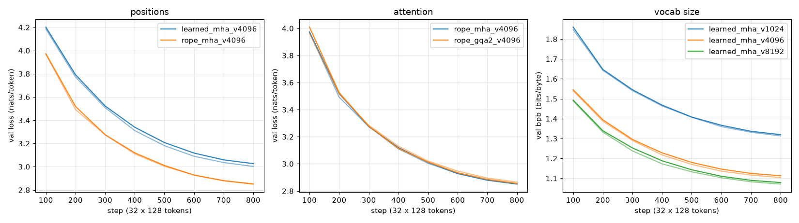

<div align="center">

# tinyformer

**One set of transformer blocks written from scratch in PyTorch, used for a GPT-style language
model, a Vision Transformer and a CLIP model. Each one is checked against a reference
implementation by loading published weights (GPT-2 small, ViT-B/16, CLIP ViT-B/32) and matching
its outputs. A byte-level BPE tokenizer, also from scratch, gives exactly tiktoken's ids when
loaded with GPT-2's ranks. Text-to-image search runs on
[vecdex](https://github.com/vik-bit/vecdex), my C++ HNSW library.**


</div>

---

## At a glance

| | |
|---|---|
| **What I built** | `tinyformer/model.py` (349 lines): multi-head attention written out as softmax(QKᵀ/√d)V, causal or bidirectional, with RoPE or learned positions, LayerNorm or RMSNorm, GELU / tanh-GELU / QuickGELU / SwiGLU MLPs, grouped-query attention, a KV cache and weight tying. The same `Block`/`Trunk` builds `GPT`, `ViT` and `CLIP`. `tinyformer/tokenizer.py`: byte-level BPE training and encoding. |
| **Verified against** | Hugging Face GPT-2 small (logits within **9.2e-5**, 8/8 greedy generations identical), timm ViT-B/16 (logits within **1.2e-5** on real photos), Hugging Face CLIP ViT-B/32 (embeddings within **3.3e-6**), tiktoken GPT-2 (**identical ids** on 2.26 MB of text). [Details ↓](#what-is-verified-against-what) |
| **Trained** | 1.3M-parameter TinyStories LMs on a laptop CPU, 5 configs × 2 seeds (RoPE beats learned positions by 0.16 nats; GQA costs 0.009 nats, which is within seed noise). A 1.2M-parameter ViT on CIFAR-10 (74.5% test accuracy, 15 epochs). A 4M-parameter CLIP trained from scratch on Flickr8k. |
| **Retrieval** | Flickr8k text→image with vecdex: pretrained CLIP ViT-B/32 running in this code gets **R@1 53.7 / R@5 80.6 / R@10 88.7**. The from-scratch CLIP gets 1.2 / 5.0 / 8.9. vecdex's top-10 equals exact search on 93.8% and 99.96% of queries. |
| **Not done** | The 10–30M-parameter LM and the longer GPU runs are in [`notebooks/train_t4.ipynb`](notebooks/train_t4.ipynb) but **have not been run**. No numbers here come from them. [Full list ↓](#what-was-not-measured) |

All numbers below come from the JSON files in [`results/`](results/), measured on an Intel
i7-1255U laptop (no GPU), PyTorch 2.15 CPU, fp32.

---

## What is verified against what

| Component | Reference | How | Result |
|---|---|---|---|
| BPE encoder | tiktoken `gpt2` | load GPT-2's 50,257 ranks into this encoder; encode the 2.26 MB TinyStories val split | **identical token ids**, all 554,025 of them ([tokenizer.json](results/tokenizer.json)); exact-match test in CI |
| Decoder LM | HF `GPT2LMHeadModel` (gpt2, 124M) | convert weights (split fused QKV, transpose Conv1D); 8 prompts, plus 1024 random tokens to use every position | max \|Δlogit\| **9.2e-5** (prompts), 7.6e-5 (1024 tokens); top-1 68/68; greedy 40-token continuations **identical on 8/8**, with and without KV cache — [verify_gpt2.json](results/verify_gpt2.json) |
| ViT | timm `vit_base_patch16_224.augreg2_in21k_ft_in1k` | 8 Flickr8k photos through timm's own preprocessing | max \|Δlogit\| **1.2e-5**, max \|Δprob\| 6.3e-7, top-1 8/8 (8 different classes) — [verify_vit.json](results/verify_vit.json) |
| CLIP | HF `openai/clip-vit-base-patch32` | 16 Flickr8k photos × their 80 captions, HF processor | image embeds **3.3e-6**, text embeds **2.4e-6**, logits 2.7e-5 (at logit scale 100); best caption 16/16 — [verify_clip.json](results/verify_clip.json) |
| Attention maths | `F.scaled_dot_product_attention` | causal + bidirectional, MHA / GQA / MQA | within 1e-5 (CI) |
| KV cache | full forward pass | step-by-step logits vs one pass; cached vs uncached generation | equal (CI, every config variant) |
| Same converters, tiny random configs | HF GPT-2, timm ViT, HF CLIP | no downloads, so runs in CI | < 1e-4 (CI) |
| vecdex search | exact brute-force inner product | same embeddings, M=16, ef_construction=200, ef=64 | recall within 0.2 pt of exact; top-10 sets overlap 99.3% / 100% |

`pytest -q` runs 56 tests on CPU in about 40 s: tokenizer round trips (Unicode, emoji, control
bytes, unseen words), the tiktoken match, shape/causality tests for every config variant, the
RoPE relative-position property, one-batch overfit tests for the LM and CLIP, and the
tiny-config reference matches.

---

## Results

### Tokenizer: compression on held-out TinyStories

The BPE is trained on the 20.2 MB train split, and bytes/token is measured on the 2.26 MB held-out
split ([tokenizer.json](results/tokenizer.json), [`scripts/tokenizer_compare.py`](scripts/tokenizer_compare.py)).

| Tokenizer | Vocab | Bytes / token (higher = better compression) | Train time |
|---|---:|---:|---:|
| tiktoken GPT-2 (reference) | 50,257 | 4.07 | — |
| this encoder + GPT-2 ranks | 50,257 | 4.07 (same ids) | — |
| this BPE, trained on TinyStories | 512 | 2.43 | 13 s |
| | 1,024 | 3.19 | 14 s |
| | 2,048 | 3.69 | 13 s |
| | 4,096 | 3.99 | 18 s |
| | 8,192 | **4.11** | 13 s |

Trained on this domain, an 8k vocabulary compresses the held-out stories slightly better than GPT-2's
general-purpose 50k vocabulary. Training uses incremental pair counts and a lazy max-heap, so the
cost is mostly the regex pre-tokenisation. Encoding is pure Python with a per-chunk cache: 0.7–1.8 MB/s, against
5.0–7.1 MB/s for tiktoken in the same single-call measurement (two runs; rough, on a shared CPU).

### LM ablations on CPU (TinyStories, 2 seeds each)

d_model 128, 4 layers, 4 heads, context 128, batch 32, 800 AdamW steps (3.3M tokens), cosine LR
2e-3. Val loss is measured on 82k held-out tokens. Bits per byte normalises by the UTF-8 bytes
those tokens cover, so different vocabularies can be compared ([ablations.json](results/ablations.json),
[`scripts/ablate_lm.py`](scripts/ablate_lm.py)).



| Config | Params | Val loss, seed 0 / 1 (nats/token) | Val bits/byte, seed 0 / 1 |
|---|---:|---|---|
| learned positions, MHA, vocab 4096 | 1.33M | 3.027 / 3.002 | 1.113 / 1.104 |
| **RoPE**, MHA, vocab 4096 | 1.31M | **2.851 / 2.850** | **1.048 / 1.048** |
| RoPE, **GQA (2 KV heads for 4 Q heads)**, vocab 4096 | 1.25M | 2.855 / 2.865 | 1.050 / 1.054 |
| learned, MHA, **vocab 1024** | 0.94M | 2.868 / 2.854 | 1.320 / 1.313 |
| learned, MHA, **vocab 8192** | 1.85M | 3.022 / 3.001 | 1.079 / 1.071 |

- **RoPE vs learned positions:** 0.16 nats lower (−0.06 bits/byte). Both seeds agree, and the gap is
  about 6× the seed-to-seed spread. At this small budget, learned position embeddings are still
  being learned while RoPE gets relative position for free.
- **MHA vs GQA:** grouped-query attention halves the KV cache and costs +0.009 nats (mean of two
  seeds). That is smaller than the 0.025 spread between seeds of the baseline, so at this scale
  I can't tell the two apart.
- **Vocab size:** compare bits per byte, not loss per token. At an equal token budget, larger
  vocabularies win (1.32 → 1.11 → 1.07). This is partly because each token covers more text, so the
  8k model sees about 1.6× more bytes than the 1k model in the same 3.3M tokens. The comparison
  is at equal compute, not equal data.
- These are 1.3M-parameter models after 800 steps. They show what this code does at small scale,
  not general claims about architectures. Wall-clock times aren't compared, because other jobs
  shared the CPU.

Sample from the RoPE model, seed 0, temperature 0.8, top-k 50, prompt in bold: **Once upon a time, a
little dog named Max** lived on a small house. Spot loved to play until he saw many food. He wanted
to go to the park and play with his room. The grammar is mostly right but the story has no
coherence, as you'd expect from a 1.3M-parameter model.

### KV cache: greedy decoding speed (batch 1, CPU, 4 threads)

Cached and uncached runs are asserted to produce identical tokens ([kvcache.json](results/kvcache.json),
[`scripts/bench_kvcache.py`](scripts/bench_kvcache.py)). Median of 3.

| Model | Prompt + new tokens | With cache | Without | Speedup |
|---|---|---:|---:|---:|
| GPT-2 small (124M) | 16 + 64 | 16.3 tok/s | 3.4 tok/s | 4.8× |
| GPT-2 small | 16 + 256 | 15.3 tok/s | 1.5 tok/s | 9.9× |
| GPT-2 small | 512 + 128 | 12.4 tok/s | 0.24 tok/s | **52×** |
| trained 1.3M model | 8 + 112 | 64 tok/s | 43 tok/s | 1.5× |

Without a cache, every new token re-runs the whole prefix, so the speedup grows with sequence length.
For the 1.3M model, per-step Python overhead dominates, so caching gains little. The CIFAR job was
training on other cores during this benchmark, so absolute tok/s are lower than on an idle machine.
The speedup ratios are the meaningful part.

### ViT on CIFAR-10 (from scratch, CPU)

Patch 4 (64 patches + CLS), d 128, 6 layers, 4 heads, **1.21M params**. Random-crop + flip, label
smoothing 0.1, AdamW, cosine LR, batch 128, 15 epochs, 1 seed. Accuracy is on the full 10,000-image
test set ([`scripts/train_vit_cifar.py`](scripts/train_vit_cifar.py)).

| epoch | 1 | 3 | 5 | 8 | 10 | 12 | 14 | 15 |
|---|---|---|---|---|---|---|---|---|
| train loss | 1.908 | 1.502 | 1.370 | 1.235 | 1.153 | 1.089 | 1.052 | 1.041 |
| test accuracy | 43.9% | 56.7% | 61.9% | 68.6% | 71.4% | 73.6% | 74.5% | **74.5%** |

Final test accuracy is **74.52%** (best is also 74.52%, at epochs 14 and 15). This is one seed, so I
give no confidence interval across seeds. At n=10,000 the binomial standard error on the test
estimate alone is about ±0.4 pt. Accuracy was still rising when the cosine schedule reached zero, so
a longer run would likely do better. Each epoch took about 11 minutes on a shared laptop CPU (4
threads), 2.9 h in total. The per-epoch log is in [`results/vit_cifar_log.jsonl`](results/vit_cifar_log.jsonl).

### CLIP and Flickr8k text→image retrieval

Flickr8k standard split: train 6,000 / val 1,000 / test 1,000 images, 5 captions each. Retrieval
queries are the 5,000 test captions against the 1,000 test images. Embeddings are computed by
this repo's CLIP and searched with vecdex (HNSW, M=16, ef_construction=200, ef=64, inner
product), alongside exact brute-force search. The 95% CIs are bootstrap over queries (2,000
resamples), so they cover query sampling, not training variance ([retrieval.json](results/retrieval.json)).

| Model | Search | R@1 | R@5 | R@10 |
|---|---|---|---|---|
| CLIP ViT-B/32, OpenAI weights in tinyformer (151M) | exact | 53.8 [52.4, 55.1] | 80.8 [79.7, 81.9] | 88.9 [88.0, 89.7] |
| | **vecdex** | **53.7** [52.3, 55.0] | **80.6** [79.5, 81.6] | **88.7** [87.8, 89.5] |
| small CLIP from scratch (4.06M) | exact | 1.2 [0.9, 1.5] | 5.0 [4.4, 5.7] | 8.9 [8.1, 9.7] |
| | **vecdex** | **1.2** [0.9, 1.5] | **5.0** [4.4, 5.7] | **8.9** [8.1, 9.7] |
| random ranking | — | 0.1 | 0.5 | 1.0 |

- **Pretrained:** the same weights running in this code give 53.8 R@1. Image→text (exact) is
  71.1 / 91.9 / 95.7.
- **From scratch:** this is a 64×64 ViT (patch 8, d 192, 4 layers) plus a 4-layer text tower over
  this repo's BPE (2,048 vocab, trained on the train captions), with InfoNCE and a learnable
  temperature. It ran 20 epochs (920 steps, 75 min on CPU, 1 seed). R@10 of 8.9% is about 9× chance
  but far below pretrained. Contrastive learning from 6,000 images is badly data-starved: CLIP
  was trained on 400M pairs. The learnable temperature barely moved in 920 steps (0.0700 →
  0.0708). Validation R@10 was still rising slowly (8.3% at epoch 14, 8.7% at 17–20) as the cosine LR decayed, so a longer run would probably help a little ([clip_scratch_log.jsonl](results/clip_scratch_log.jsonl)).
- **vecdex vs exact:** on 1,000 vectors, HNSW at ef=64 returns exactly the brute-force top-10 for
  93.8% (pretrained) and 99.96% (scratch) of queries. Set overlap is 99.3% / 100%, and recall@K
  differs by at most 0.2 points. At this size exact search is also fast (0.8 s for all 5,000 queries
  in numpy), so this checks correctness rather than demonstrating a speed gain.

---

## What was not measured

- **The 10–30M-parameter LM** (planned: 17M, d 384, 8 layers, seq 512) and its RoPE / GQA /
  SwiGLU+RMSNorm variants at that size. They are written up in [`notebooks/train_t4.ipynb`](notebooks/train_t4.ipynb)
  for a Kaggle/Colab T4 but have not been run. On this laptop a 4M model trains at about 2k
  tokens/s, which is too slow.
- A longer CIFAR-10 schedule (the notebook has 100 epochs at d 256), multiple CIFAR seeds, and
  multiple seeds for the scratch CLIP.
- Flickr30k: only Flickr8k was used.
- Fused/flash attention speed. Attention is deliberately explicit; it is checked against
  `F.scaled_dot_product_attention` for correctness only.
- Comparing the tokenizer's speed to tiktoken beyond the single encode-throughput number above.
- Any GPU number.

---

## Layout

```
tinyformer/
  model.py       Config, Attention (RoPE, GQA, KV cache), MLP, Block, Trunk, GPT, ViT, TextEncoder, CLIP
  tokenizer.py   byte-level BPE: train / encode / decode / save / from_tiktoken
  convert.py     HF GPT-2, timm ViT and HF CLIP weights -> tinyformer (strict loads)
  data.py        TinyStories split, token files, batches
  flickr.py      Flickr8k parquet loader
  clip_train.py  small from-scratch CLIP: architecture, transforms, tokenizer glue
scripts/         verify_gpt2 / verify_vit / verify_clip, tokenizer_compare, train_lm, ablate_lm,
                 bench_kvcache, train_vit_cifar, train_clip, embed_flickr, retrieval (+ wsl_retrieval.sh)
tests/           test_tokenizer, test_model, test_reference (all CPU, run in CI)
results/         every number in this README, as JSON
notebooks/       train_t4.ipynb (not yet run)
```

## Reproduce

```bash
pip install torch --index-url https://download.pytorch.org/whl/cpu
```
```bash
pip install -e ".[ref,dev]" && pytest -q
```
```bash
python scripts/verify_gpt2.py
```

Then: `scripts/tokenizer_compare.py` (needs `data/TinyStoriesV2-GPT4-valid.txt`),
`scripts/ablate_lm.py run`, `scripts/verify_clip.py` and `scripts/embed_flickr.py pretrained`
(need the Flickr8k parquet files in `data/flickr8k/`), and
`wsl -d Ubuntu -- bash scripts/wsl_retrieval.sh pretrained scratch`. vecdex builds on Linux and
macOS, so on Windows it runs under WSL.

## Data and weights

| | Source | Licence / terms |
|---|---|---|
| TinyStories V2 (GPT-4) | `roneneldan/TinyStories` on Hugging Face | CDLA-Sharing-1.0 |
| Flickr8k | `jxie/flickr8k` (HF mirror of Hodosh, Young & Hockenmaier 2013) | The mirror states no licence. The original UIUC release is for research use, and the images belong to their Flickr owners. This repo contains no images, only metrics. |
| CIFAR-10 | cs.toronto.edu (MD5 checked) | Krizhevsky 2009, free for research |
| GPT-2 small | `gpt2` on Hugging Face | MIT |
| ViT-B/16 | timm `vit_base_patch16_224.augreg2_in21k_ft_in1k` | Apache-2.0 |
| CLIP ViT-B/32 | `openai/clip-vit-base-patch32` | MIT |
